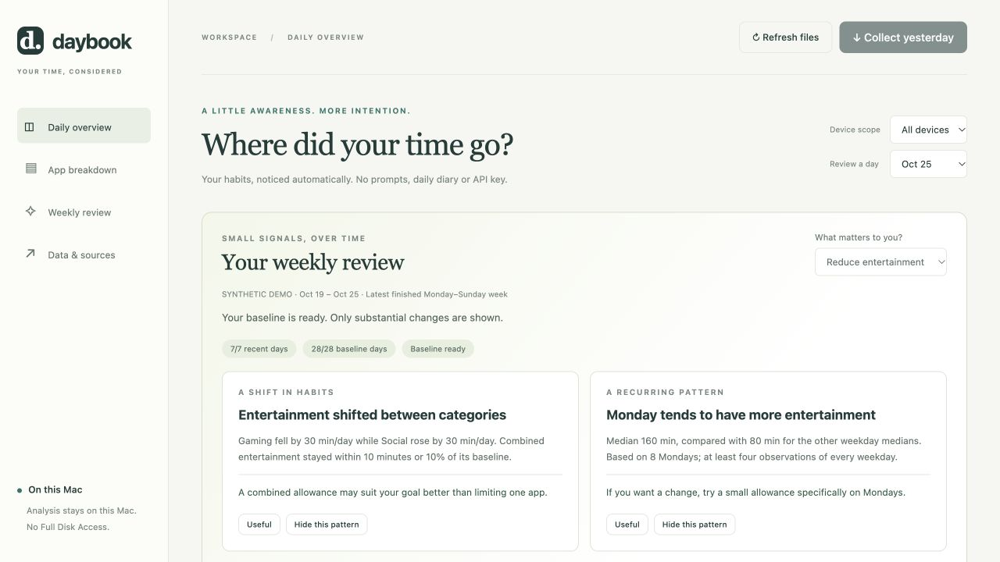

# Daybook

A private weekly review of your screen habits, without an API key.

Daybook imports daily Apple Screen Time exports, learns your routine, and highlights a few substantial changes. It uses transparent calculations and carefully written suggestions. No account, model, subscription, telemetry or Full Disk Access is required by Daybook.

**Developer alpha · macOS companion · daily totals.** This is an independent project, not affiliated with Apple. The collector depends on a Shortcuts action that may differ across OS versions; availability and unattended execution must be checked on each device.



## Download and compatibility

[Download the ready-to-run alpha ZIP](https://github.com/PittsIrv/daybook/releases/download/v0.1.0-alpha/daybook-0.1.0-alpha.zip) · [All releases](https://github.com/PittsIrv/daybook/releases)

The ZIP includes the **complete dashboard and a signed Shortcut**. No GPT, code generation, API key, developer account, Node.js, build step or Python package installation is needed. You do need a Python interpreter. GitHub's **Code → Download ZIP** contains source; use the release ZIP above for the included signed Shortcut.

| Requirement | What to expect |
|---|---|
| Python | Python 3.9+; install from [python.org](https://www.python.org/downloads/macos/) if missing. macOS does not guarantee a usable Python installation. |
| Live collection | macOS with **Get App & Website Activity** available in Shortcuts. Installed Apple metadata lists OS 26 introduction; live collection has been tested only on macOS 27 on Apple silicon. |
| Dashboard | A current browser. Python and browser code have no architecture-specific extensions, but Intel Macs have not been tested. |
| iPhone/iPad data | Same Apple account, Screen Time sharing enabled, and the chosen Shortcut device scope. Sync may be delayed. |
| First run | Choose the device scope and resolve Shortcuts' permission prompts once. No Full Disk Access is requested. |

A signed Shortcut is not a notarized Mac application. This alpha is a folder of inspectable source, with optional `.command` launchers. If macOS refuses a downloaded launcher, follow the Terminal commands below; do not disable Gatekeeper or run quarantine-removal commands.

## Try the fictional demo

Requires Python 3.9+ and a current browser. From the downloaded project folder:

```bash
python3 dashboard/launch.py --demo
```

The demo contains 56 generated days and never reads your iCloud exports or invokes Shortcuts. Demo settings are separate from personal settings. The demo clock is fixed to October 26, 2026 so its examples stay reproducible.

## Use your data

Unzip the release and move its `daybook` folder somewhere permanent. Open Terminal in that folder, or type `cd ` (with a space), drag the folder into Terminal and press Return. All commands below run from that folder. The same finished dashboard is included for every user.


1. Import `shortcuts/Screen Time Yesterday.shortcut` from the release ZIP. The source repository includes a generator; see [Shortcut setup](shortcuts/README.md).
2. In Shortcuts, expand **Get App & Website Activity** and verify the device selection. Choose the same scope every time, such as All Devices. Run it once and resolve any permissions in Shortcuts.
3. Start Daybook:

   ```bash
   python3 dashboard/launch.py
   ```

4. To start automatically when you log in, keep the project in a permanent folder, stop the manually running server with Control-C, and run:

   ```bash
   python3 dashboard/manage.py install
   ```

   Open <http://127.0.0.1:8765> to check the collection status. Remove the login service with `python3 dashboard/manage.py uninstall`; this retains your data.

To check setup without collecting anything:

```bash
python3 dashboard/doctor.py
```

You can also double-click `dashboard/Start Daybook.command` or `dashboard/Start Demo.command`. The launcher opens an existing matching dashboard instead of starting a second copy. Demo mode uses port 8766, so it can run alongside personal tracking on port 8765.

Once running, Daybook checks every 15 minutes and collects yesterday after 8 AM in the Mac's local timezone. A successful collection suppresses further automatic runs for that target day. Failures retry at most three times per day, at least one hour apart. It does not wake a sleeping Mac. It does not backfill days missed while the Mac was off. Use **Collect yesterday** to retry after an Apple sync delay.

No iPhone automation is installed by this project. iPhone exports can sync through iCloud, but locked-phone execution and automation setup need separate verification. The Mac Shortcut may include shared Apple-device activity when Apple Screen Time sharing and the selected device scope provide it; Daybook cannot guarantee timely or complete iCloud synchronization.

## What the review does

- Compares the last finished Monday–Sunday week with the preceding four weeks, matching weekdays.
- Requires seven eligible recent days and at least three examples of every weekday in the baseline. Missing days are never filled with zeros.
- Highlights category changes of at least 15 minutes/day and 20%, with a baseline of at least 10 minutes/day and at least five recent days moving in the same direction.
- Detects opposing entertainment-category changes of at least 15 minutes/day while combined entertainment stays within 10 minutes/day or 10% of baseline. This describes a shift, not its cause.
- Finds unusually high entertainment weekdays using up to eight weeks, at least four observations of every weekday, and a median difference of at least 30 minutes and 25%.
- Shows at most three findings. **Useful** raises a pattern's priority; **Hide this pattern** suppresses it until reset.
- Applies a few conservative app defaults. Browsers, YouTube and general-purpose AI tools stay Mixed. Corrected labels apply consistently to all dates.
- Offers optional goals. Advice for reducing entertainment is shown only when that goal is selected. Focus labels are not evidence of learning or completed work.

These are transparent heuristics, not validated psychological measures or statistical significance tests. Early users will usually see **Still learning** for several weeks. A quiet report is better than an invented insight.

Weekly Markdown reviews are written automatically while the service runs. This alpha does not send email or native notifications. Reviewing the dashboard or opening a saved report is optional; collecting does not require either.

## Where the files live

- Exports: **iCloud Drive → Shortcuts → ScreenTime → snapshots**. The `.txt` files contain JSON.
- Mac input: `~/Library/Mobile Documents/iCloud~is~workflow~my~workflows/Documents/ScreenTime/snapshots`.
- Preferences and collection status: `~/Library/Application Support/Daybook/`.
- Weekly reviews: `~/Library/Application Support/Daybook/reports/` (one file per week and device scope).
- Service logs: `~/Library/Logs/Daybook/`.
- Optional local exports: `dashboard/data/` (never include these in a release).

Analysis stays local. iCloud still handles export synchronization under your Apple account. Nothing in the dashboard sends activity to an AI provider. The server binds only to loopback; don't expose its port publicly.

## Limits that matter

Daily totals cannot reveal precise sessions, late-night use, context switches, intent within Chrome or actual productivity. Exported app and website rows can overlap, and devices can be used simultaneously. Reported activity is not unique elapsed time. Even a completed-day query can change after iCloud catches up.

Empty exports and exports with unparsed rows are excluded from insights rather than treated as zero. English and Chinese duration formats are supported. Changing the device selection under the same `configured_device` scope mixes histories; start a fresh data folder or change the scope metadata consistently if you change what is being measured.

## Development

Python standard library and plain HTML/CSS/JavaScript; no runtime package installation.

```bash
python3 -m unittest discover -s dashboard/tests -v
python3 scripts/make_demo.py
python3 scripts/package_release.py
```

Use `--no-auto` to inspect real exports without invoking Shortcuts, `--data-dir /path/to/exports` to select one input folder, and `--state-dir /path/to/state` to isolate settings. See [verification](docs/VERIFICATION.md) and [release guide](docs/RELEASING.md).

## Related projects

[ScreenTimeAnalyzer](https://github.com/fildl/ScreenTimeAnalyzer) also uses Shortcut snapshots and a local dashboard. [ActivityWatch](https://activitywatch.net/) provides extensible local automatic tracking. [Screen Time Exporter](https://github.com/nichtlegacy/screentime) offers richer Apple-store imports with Full Disk Access. Daybook focuses on a small, inspectable daily workflow and low-maintenance weekly reviews. No code from these projects is bundled.

MIT licensed. See [LICENSE](LICENSE).
