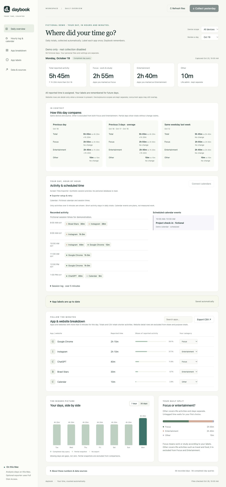

# Daybook

Your daily app time, counted automatically and available to your own agent.

Daybook imports Apple Screen Time exports and shows hours and minutes per app, with three purposes: **Focus** (work and study), **Entertainment**, and **Other** (life activities such as food and travel). Label an app once; its purpose is remembered for past and future days. Newly seen names appear in a setup queue. No daily diary, AI model, API key, subscription, telemetry or Full Disk Access is required by Daybook.

**The source checkout has the new daily-totals, comparison, timeline and local MCP experience. The published v0.1.0-alpha ZIP still contains the earlier weekly-review interface.**

**Developer alpha · macOS companion · daily totals and optional session imports.** This is an independent project, not affiliated with Apple. The collector depends on a Shortcuts action that may differ across OS versions; availability and unattended execution must be checked on each device.



## Use Daybook through your agent

The source checkout includes a **read-only local MCP server**. Your agent can query daily app time, saved purposes, comparisons, and hourly sessions when available. Calendar event titles are opt-in. It reads the same records as the dashboard and does not require a browser or an HTTP listener. The background collectors remain responsible for importing data.

```bash
python3 dashboard/mcp_config.py
```

Add the printed command and arguments to a local agent that supports stdio MCP. The launcher uses uv to manage Python and the optional official MCP SDK. See the [MCP setup guide](docs/MCP.md) for one-time installation, tool descriptions, privacy, sleep behavior, and what still requires the background service. No agent settings are changed automatically. The old release ZIP does not include this interface yet.

## Download and compatibility

[Download the ready-to-run alpha ZIP](https://github.com/PittsIrv/daybook/releases/download/v0.1.0-alpha/daybook-0.1.0-alpha.zip) · [All releases](https://github.com/PittsIrv/daybook/releases)

The ZIP includes the **complete dashboard and a signed Shortcut**. No GPT, code generation, API key, developer account, Node.js, build step or Python package installation is needed. You do need a Python interpreter. GitHub's **Code → Download ZIP** contains source; use the release ZIP above for the included signed Shortcut.

| Requirement | What to expect |
|---|---|
| Python | Python 3.9+; install from [python.org](https://www.python.org/downloads/macos/) if missing. macOS does not guarantee a usable Python installation. |
| Live collection | macOS with **Get App & Website Activity** available in Shortcuts. Installed Apple metadata lists OS 26 introduction; live collection has been tested only on macOS 27 on Apple silicon. |
| Dashboard | A current browser. Python and browser code have no architecture-specific extensions, but Intel Macs have not been tested. |
| iPhone/iPad data | Same Apple account, Screen Time sharing enabled, and the chosen Shortcut device scope. Sync may be delayed. |
| First run | Choose the device scope and resolve Shortcuts' permission prompts once. No Full Disk Access is requested. |

A signed Shortcut is not a notarized Mac application. This alpha is a folder of inspectable source, with optional `.command` launchers. If macOS refuses a downloaded launcher, follow the Terminal commands below; do not disable Gatekeeper or run quarantine-removal commands.

## Try the fictional demo

Requires Python 3.9+ and a current browser. From the downloaded project folder:

```bash
python3 dashboard/launch.py --demo
```

The demo contains 56 generated days and never reads your iCloud exports or invokes Shortcuts. Demo settings are separate from personal settings. The demo clock is fixed to October 26, 2026 so its examples stay reproducible.

## Use your data

Unzip the release and move its `daybook` folder somewhere permanent. Open Terminal in that folder, or type `cd ` (with a space), drag the folder into Terminal and press Return. All commands below run from that folder. The same finished dashboard is included for every user.


1. Import `shortcuts/Screen Time Yesterday.shortcut` from the release ZIP. The source repository includes a generator; see [Shortcut setup](shortcuts/README.md).
2. In Shortcuts, expand **Get App & Website Activity** and verify the device selection. Choose the same scope every time, such as All Devices. Run it once and resolve any permissions in Shortcuts.
3. Start Daybook:

   ```bash
   python3 dashboard/launch.py
   ```

4. To start automatically when you log in, keep the project in a permanent folder, stop the manually running server with Control-C, and run:

   ```bash
   python3 dashboard/manage.py install
   ```

   Open <http://127.0.0.1:8765> to check the collection status. Remove the login service with `python3 dashboard/manage.py uninstall`; this retains your data.

To check setup without collecting anything:

```bash
python3 dashboard/doctor.py
```

You can also double-click `dashboard/Start Daybook.command` or `dashboard/Start Demo.command`. The launcher opens an existing matching dashboard instead of starting a second copy. Demo mode uses port 8766, so it can run alongside personal tracking on port 8765.

Once running, Daybook checks every 15 minutes and collects yesterday after 8 AM in the Mac's local timezone. A successful collection suppresses further automatic runs for that target day. Failures retry at most three times per day, at least one hour apart. It does not wake a sleeping Mac. It does not backfill days missed while the Mac was off. Use **Collect yesterday** to retry after an Apple sync delay.

No iPhone automation is installed by this project. iPhone exports can sync through iCloud, but locked-phone execution and automation setup need separate verification. The Mac Shortcut may include shared Apple-device activity when Apple Screen Time sharing and the selected device scope provide it; Daybook cannot guarantee timely or complete iCloud synchronization.

## Daily totals and one-time labels

- The main view shows total reported activity, Focus, Entertainment and Other in hours and minutes, immediately after the first export. It does not need several weeks of history.
- The app breakdown shows time and share for apps or websites with more than five minutes, with an optional category dropdown. The 7/30-day chart shows daily totals.
- Each newly observed name appears in **App labels** until you choose its purpose. The queue is shown when opening or refreshing the dashboard; it is not a native notification. Collection continues without waiting for labels.
- Labels persist on the Mac and apply across dates and device scopes. They never require daily confirmation. Changing a label recalculates past and future breakdowns.
- Focus includes work and study. Other stays separate; Daybook never invents a work/leisure ratio for a browser.
- Untagged is a temporary setup state, not a fourth purpose. Its time remains in the total and is displayed explicitly until assigned.
- Suggested labels are optional: known games/social/streaming apps suggest Entertainment, selected code editors suggest Focus, and other names suggest Other. Nothing is applied without choosing a label or confirming the displayed suggestions.
- Explicit old Gaming/Social/Video/Leisure labels migrate to Entertainment, Utility and Mixed to Other, and Focus remains unchanged. Previously automatic defaults do not count as user confirmation.
- CSV exports and saved daily Markdown reports use the same labels. Reports are refreshed automatically while the service runs. Historical weekly reports are retained; new reports contain daily quantities rather than advice or experiments.

The active dashboard does not invoke the legacy weekly-insight engine. No goals, experiments, AI coaching or daily reflection tasks are part of the current experience.

### Mac application distribution

A bundled Mac app can be developed and tested without paid Apple Developer Program membership. A publisher needs membership for Developer ID signing and notarization of a public download; end users do not need developer accounts. Apple lists the program at US$99/year (local pricing may vary). A notarized app can still be distributed through GitHub, without an App Store listing. See [Apple's Developer ID guidance](https://developer.apple.com/developer-id/) and [program enrollment](https://developer.apple.com/programs/enroll/).

The current alpha is still a Python source distribution. A bundled runtime, guided setup and application signing are planned, not included in this release.

## Hourly activity, calendar and comparisons

See the [integration setup guide](docs/INTEGRATIONS.md). The optional exporter requires Full Disk Access; Daybook reads only its exported SQLite database. It can import historical sessions still retained by Apple, including phone records synced to the Mac. It does not need an hourly iPhone automation. Apple sync delays and retention limits still apply.

The hourly view and session log show activity over five minutes. Short activity remains in daily totals and CSV. Calendar events are shown separately as scheduled time, never added to measured activity. Google calendars can sync through Apple Calendar using the optional local EventKit helper. Choose calendars once; while Daybook runs, it refreshes them every 15 minutes.

Comparisons show the selected day versus the previous day, the average of the previous three calendar days, and the same weekday last week. They stay within one device/source scope. Missing baselines are not zero; partial days do not produce whole-day change claims.

## Where the files live

- Exports: **iCloud Drive → Shortcuts → ScreenTime → snapshots**. The `.txt` files contain JSON.
- Mac input: `~/Library/Mobile Documents/iCloud~is~workflow~my~workflows/Documents/ScreenTime/snapshots`.
- Preferences and collection status: `~/Library/Application Support/Daybook/`.
- Daily reports: `~/Library/Application Support/Daybook/reports/daily-<date>-<scope-hash>.md`. Earlier weekly reports are retained.
- Service logs: `~/Library/Logs/Daybook/`.
- Optional local exports: `dashboard/data/` (never include these in a release).

Analysis stays local. iCloud still handles export synchronization under your Apple account. The dashboard sends no activity to an AI provider. When you connect the optional MCP, your chosen agent may send tool results to its own model provider according to its settings. The server binds only to loopback; don't expose its port publicly.

## Limits that matter

Daily Shortcut totals cannot reveal sessions or hours. The optional exporter supplies app-session times, but does not establish intent within Chrome or actual productivity. When a browser is present, website rows from Shortcuts are detail-only and excluded from totals. Devices and different apps can still overlap. Reported activity is not unique elapsed time. Even a completed-day query can change after iCloud catches up.

Empty exports and exports with unparsed rows are excluded from insights rather than treated as zero. English and Chinese duration formats are supported. Changing the device selection under the same `configured_device` scope mixes histories; start a fresh data folder or change the scope metadata consistently if you change what is being measured.

## Development

The core uses Python standard library and plain HTML/CSS/JavaScript. Optional Screen Time Exporter and the native calendar bridge have separate setup requirements.

```bash
python3 -m unittest discover -s dashboard/tests -v
python3 scripts/make_demo.py
python3 scripts/package_release.py
```

Use `--no-auto` to inspect real exports without invoking Shortcuts, `--data-dir /path/to/exports` to select one input folder, and `--state-dir /path/to/state` to isolate settings. See [verification](docs/VERIFICATION.md) and [release guide](docs/RELEASING.md).

## Related projects

[ScreenTimeAnalyzer](https://github.com/fildl/ScreenTimeAnalyzer) also uses Shortcut snapshots and a local dashboard. [ActivityWatch](https://activitywatch.net/) provides extensible local automatic tracking. [Screen Time Exporter](https://github.com/nichtlegacy/screentime) offers richer Apple-store imports with Full Disk Access. Daybook focuses on automatic daily quantities and one-time app-purpose setup. The optional Screen Time Exporter is installed separately; its code is not bundled in Daybook.

MIT licensed. See [LICENSE](LICENSE).
